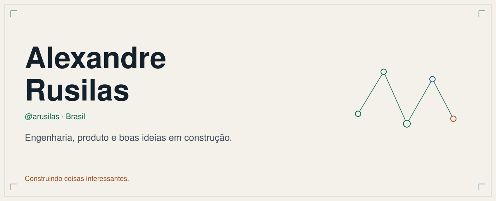
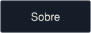
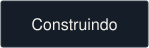
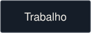
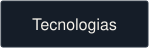
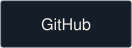
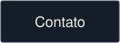
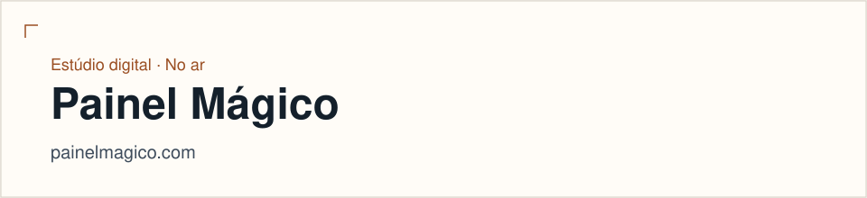
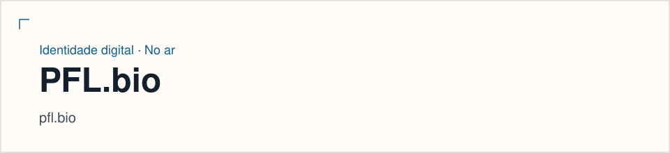
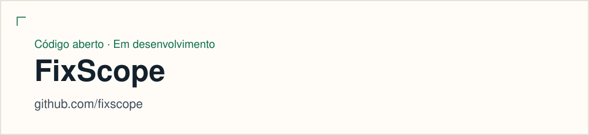

<!-- Generated from content/*.json by scripts/generate-readme.mjs. Edit the content files, then regenerate. -->

<picture>
  <source media="(max-width: 640px) and (prefers-color-scheme: dark)" srcset="./assets/readme/hero-mobile-dark.svg">
  <source media="(max-width: 640px)" srcset="./assets/readme/hero-mobile-light.svg">
  <source media="(prefers-color-scheme: dark)" srcset="./assets/readme/hero-dark.svg">
  
</picture>

# Alexandre Rusilas

<h2 id="sobre">Sobre</h2>

Olá, sou o Alexandre. Lidero a tecnologia na AppTicket, desenho arquiteturas e gosto de transformar uma ideia em produto que faça sentido para quem usa. Entre engenharia, produto e café, quase sempre tem alguma coisa em construção.

Conecto tecnologia, pessoas e negócio para transformar ideias em produtos digitais — da arquitetura à experiência de quem usa.

In English

Hi, I'm Alexandre. I lead technology at AppTicket, shape architectures, and like turning an idea into a product that makes sense for the people using it. Between engineering, product, and coffee, something is usually under construction.

Building digital products, leading technology, connecting ideas to execution.

<h2 id="mapa">Mapa</h2>

<h2 id="construindo">O que estou construindo</h2>

<picture>
  <source media="(prefers-color-scheme: dark)" srcset="./assets/readme/projects/painel-magico-dark.svg">
  
</picture>

**Painel Mágico** — Estúdio independente para transformar ideias em produtos digitais úteis, simples de usar e preparados para crescer.

<a href="https://painelmagico.com">Abrir o estúdio</a>

<picture>
  <source media="(prefers-color-scheme: dark)" srcset="./assets/readme/projects/pfl-bio-dark.svg">
  
</picture>

**PFL.bio** — Produto do ecossistema Painel Mágico: uma página para reunir links, contato e presença online.

<a href="https://pfl.bio">Conhecer o produto</a> · <a href="https://pfl.bio/@arusilas">Perfil @arusilas</a>

<picture>
  <source media="(prefers-color-scheme: dark)" srcset="./assets/readme/projects/fixscope-dark.svg">
  
</picture>

**FixScope** — Skill de IA para investigar vulnerabilidades com contexto, avaliar a exposição real e planejar remediações sem sacrificar a estabilidade. Ainda sem lançamento público. A organização no GitHub existe. Não há repositório público publicado.

<a href="https://github.com/fixscope">Ver a organização</a>

<h2 id="trabalho">Como eu trabalho</h2>

- **Arquitetura** — Projetar sistemas confiáveis, sustentáveis e que continuem claros quando crescem.
- **Engenharia** — Transformar desafios em soluções técnicas bem executadas.
- **Liderança** — Conectar pessoas, decisões e execução.
- **Produto** — Criar tecnologia que resolva problemas reais.

<h2 id="tecnologias">Tecnologias</h2>

Uma lista curta, do trabalho. Não é um catálogo de ferramentas que eu abri uma vez.

**Backend e APIs**
PHP · Laravel · Node.js · APIs REST

**Frontend e mobile**
TypeScript · JavaScript · Vue.js · Nuxt · React Native · Expo

**Dados**
MySQL · Oracle SQL

**Cloud e entrega**
AWS · Docker · CI/CD · GitHub Actions

**Prática**
Git · Arquitetura de software · Segurança de aplicações · Automação · Desenvolvimento assistido por IA

<h2 id="github">GitHub</h2>

No GitHub desde 2016. O que está público nesta conta é este perfil. A organização FixScope já existe e ainda não tem repositório publicado. Sem gráfico de vaidade: o que importa é o que está sendo construído.

<h2 id="alem">Além do código</h2>

Por trás dos commits, pouca coisa. O suficiente para o trabalho não ficar sem dono.

- Café, de preferência enquanto a arquitetura ainda está no papel.
- Produtos digitais que uma pessoa real consiga usar.
- Estratégia quando ela muda uma decisão, não quando ela enfeita.
- Construir, experimentar, e saber parar.

<h2 id="contato">Vamos conversar</h2>

Tem uma ideia interessante? Vamos conversar.

- [LinkedIn](https://www.linkedin.com/in/alexandrerusilas)
- [PFL.bio](https://pfl.bio/@arusilas)
- [GitHub](https://github.com/alexandrerusilas)
- [contato@painelmagico.com](mailto:contato@painelmagico.com)

Feito com curiosidade, código e café.

@arusilas · Brasil · Painel Mágico
